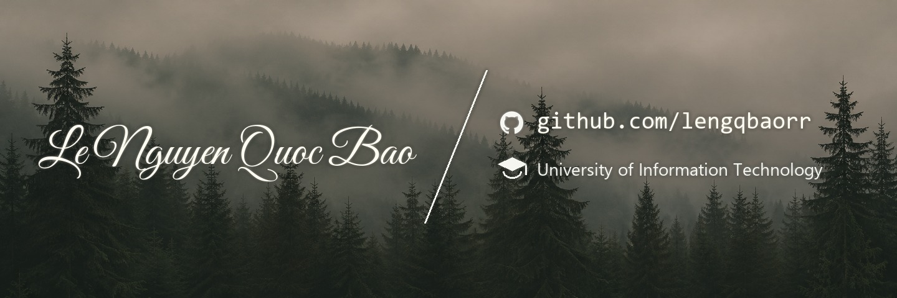
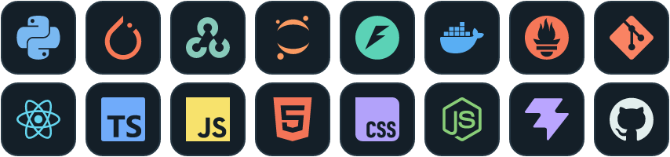
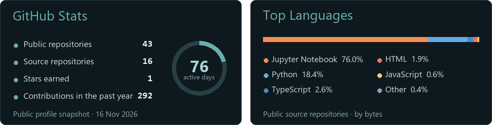

  

---

  
  
  
  
  

  

  I’m Quoc Bao, an Artificial Intelligence student at the University of Information Technology (UIT). I build systems for retrieval-augmented generation (RAG), document understanding, and computer vision.

<h2 align="center">Experience</h2>

- **VinSmart Future (VSF), Vingroup** · Internship.
- **[Vingroup 20,000 Applied AI Talent Program](https://vinuni.edu.vn/aithucchien/)** · Participant in VinUniversity’s hands-on AI training program. Product demo ranked in the **Top 10 of the Build Phase**.

<h2 align="center">Awards &amp; Certifications</h2>

- **RMIT Hack-A-Venture 2024** · **Top 10 of 120 teams**. Built a warehouse management system with route optimization and logistics tracking. [Credential](https://drive.google.com/file/d/1I9fpgyheyjxH1zp-kEhpSJ2blcOSlWjM/view?usp=drive_link)
- **SWIN Hackathon 2026** · **Top 20 of 240+ teams**. Built a multi-agent AI system to flag suspicious transaction patterns. [Credential](https://drive.google.com/file/d/1Xcxq7h4znDuAF3gh_v-nsX3UqAqv6WsY/view?usp=drive_link)
- **Applications of AI for Anomaly Detection** · NVIDIA certificate. [Credential](https://drive.google.com/file/d/1649UMylzy6IyxrlklqKGuGImatf3jXVM/view?usp=drive_link)

<h2 align="center">Tech Stack</h2>

  

<h2 align="center">Statistics</h2>

  

---

<strong>With ❤️ from Quoc Bao</strong>

