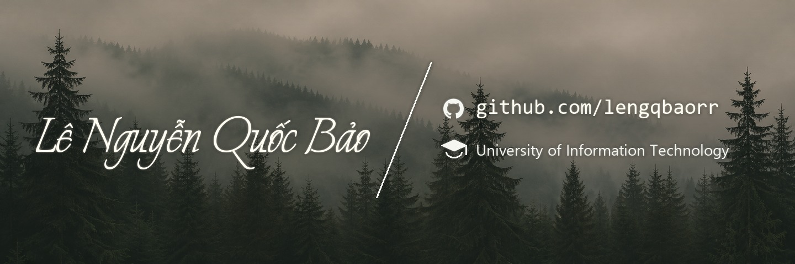

  

---

  
  
  
  

  

  I’m Quốc Bảo from the University of Information Technology (UIT). I build applied AI projects in computer vision, document understanding, and retrieval-augmented generation (RAG).

<h2 align="center">Tech Stack</h2>

  

<h2 align="center">Statistics</h2>

  

---

<strong>With ❤️ from Quốc Bảo</strong>

