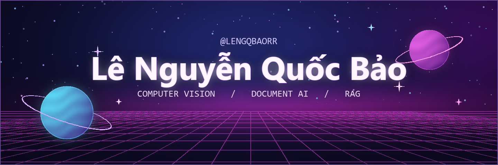
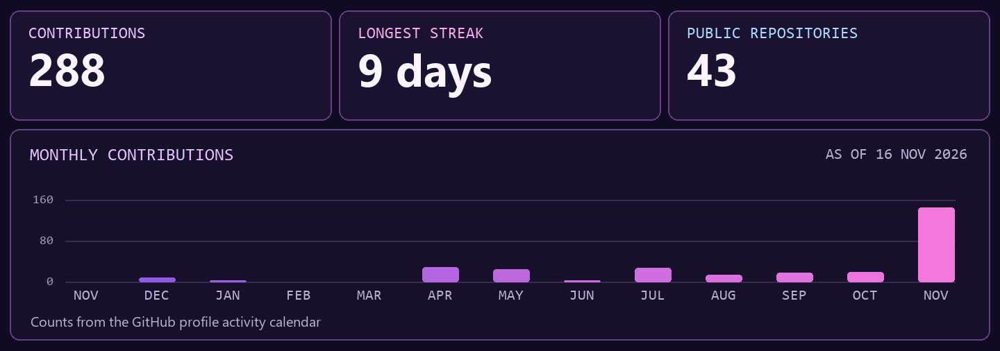

<table align="right"><tr><td><pre title="Unicode portrait of Lê Nguyễn Quốc Bảo">⠀⠀⠀⠀⠀⠀⠀⠀⠀⠀⠀⢀⠀⠀⠀⡀
⠀⠀⠀⠀⠀⠀⠀⡀⠄⠂⠡⠠⠀⢁⠐⠈⠡⠱⣄
⠀⠀⠀⠀⠀⠠⠐⠠⠈⢀⠁⠄⠐⠀⢈⠀⠂⡀⠈⢧
⠀⠀⠀⠀⠠⠁⠐⠀⡁⠄⠐⠀⡁⢈⠀⡀⠂⠀⢂⠀⠅
⠀⠀⠀⠀⡐⠈⢀⠁⡀⠂⢈⠠⠀⠄⠠⢀⠈⠄⠠⢀⠠
⠀⠀⠀⠀⢂⠁⠄⠐⠠⢈⠠⢀⠐⡀⢂⠀⡐⠀⠂⠠⠈
⠀⠀⠀⠀⠡⠐⠀⡁⠂⢂⠄⢀⠐⡀⠂⠄⠄⡑⡌⢀⠁
⠀⠀⠀⠀⡨⡐⡠⡪⣙⡩⣱⠆⣆⢰⣋⢙⡩⣢⠠⢨⢀
⠀⠀⠀⠀⢼⡃⣇⠽⢷⣯⡟⢰⣷⠠⣟⣯⣗⠗⡔⢸⢕
⠀⠀⠀⠀⢱⣕⢝⣽⢶⣶⢼⢛⢟⢳⢬⣬⡬⡮⡢⢝⠅
⠀⠀⠀⠀⠀⠫⡮⡯⡯⡯⣟⢽⢽⢵⣫⢷⢽⢱⠪⠁
⠀⠀⠀⠀⠀⠈⢎⡯⡯⣳⢦⡳⡞⡔⣬⢧⢫⢊⠆
⠀⠀⠀⠀⠀⠀⠑⡇⡏⣗⡿⣞⣯⡯⣺⡱⢑⠌
⠀⠀⠀⠀⠀⠀⠀⠨⢮⡲⣙⢕⢓⠏⡂⡮⡵⡅⠄
⠀⠀⠀⠀⢀⠠⠂⠑⣿⢽⢮⡺⡮⣺⢜⣮⢗⣕⠇⠈⠐⠀⠄⡀
⠀⡀⠔⠐⠀⠄⠐⢀⠉⠿⣯⣯⢯⣺⣵⣳⠟⠂⢀⠁⡈⠠⠀⢀⠁
⠈⡀⠐⢀⠁⠄⠐⢀⠐⠀⠠⠈⠉⠈⠂⠀⠄⡀⠂⢀⠐⢀⠁⠄
⠀⠄⠐⠀⠄⠂⠐⠀⠄⠁⠂⢈⠀⡁⢈⠠⠀⠄⠈⠀⠄⢀⠐⠀⠁</pre></td></tr></table>

## Connect with me

## About me

I'm Quốc Bảo, affiliated with the University of Information Technology (UIT).

- I build applied AI projects in computer vision, document understanding, and RAG.
- My projects cover data preparation, model training, evaluation, and deployment.
- I work with Python, Jupyter, FastAPI, and React.

 

## GitHub stats

## Featured projects

| Project | What it does |
| --- | --- |
| [**PCB-AOI**](https://github.com/lengqbaorr/PCB-AOI) | Automated optical inspection for circuit boards, with model training, inference, and a dashboard for reviewing defects. |
| [**ReceiptGraphKIE**](https://github.com/lengqbaorr/ReceiptGraphKIE) | Extracts structured fields from receipt images using LayoutLMv3, spatial graphs, and a CRF. |
| [**RAG Chatbot**](https://github.com/lengqbaorr/RAG-chatbot) | Answers questions over uploaded documents and images using a FastAPI backend and a React interface. |
| [**Realtime Translator**](https://github.com/lengqbaorr/realtime-translator) | Captures Windows system audio and transcribes it live with sherpa-onnx. |
